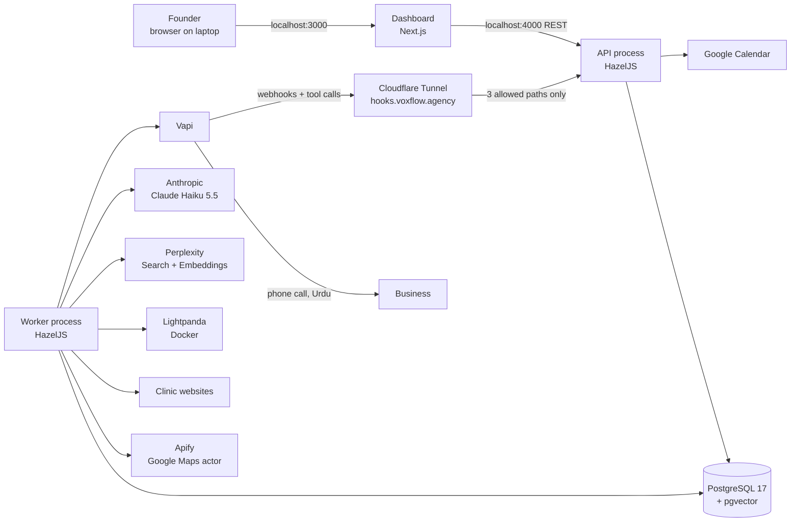

# VoxFlow Lead Engine — Architecture (v1)

| Field | Value |
| --- | --- |
| Status | Approved for build |
| Version | 1.0 (matches PRD v0.2) |
| Date | 3 Nov 2026 |
| Owner | Muhammad Fahad |
| Source of requirements | [`docs/prd.md`](./prd.md) — every FR/NFR below refers to it |
| Decisions | [`docs/adr/`](./adr/) — each major choice has an ADR |

This document says **how** v1 is built. The PRD says **what** and **why**. If the two disagree, stop and fix one of them through the change process in [`CONTRIBUTING.md`](../CONTRIBUTING.md) before writing code.

---

## 1. System context



Everything except the outside services runs on the founder's Windows laptop (ADR-0003).

## 2. Containers and processes

| Unit | Runs as | Port | Job |
| --- | --- | --- | --- |
| `apps/web` | `pnpm --filter web dev` (Next.js) | 3000, localhost only | Dashboard pages (FR-30, FR-31) |
| `apps/api` — API entry `src/main.ts` | `pnpm --filter api dev` | 4000, bound to 127.0.0.1 | REST for the dashboard, Vapi webhook + tool routes, approvals, calendar slot cache |
| `apps/api` — worker entry `src/worker.ts` | `pnpm --filter api worker` | none | Pipeline runs, call dispatcher, reconciliation, retention, backups |
| `postgres` | Docker, image `pgvector/pgvector:pg17` | 5432 | All data, vectors, HazelJS durable runs |
| `lightpanda` | Docker, image `lightpanda/browser:nightly` | 9222 (CDP) | Renders JavaScript-only websites (ADR-0004) |
| `cloudflared` | Windows service (Cycle 4) | — | Public HTTPS for 3 paths only (ADR-0003) |

There is **no Redis and no message broker** in v1 (ADR-0002). Database state is the queue: the worker polls for due work.

**Why two processes from one codebase.** The API must answer Vapi's in-call tool requests in under 2 seconds (NFR-3); long pipeline work must never block it. Both share modules, adapters and the Prisma client.

## 3. Repository layout

```
voxflow-lead-engine/
├── apps/
│   ├── api/                       # HazelJS — API + worker
│   │   └── src/
│   │       ├── main.ts            # API entry
│   │       ├── worker.ts          # Worker entry
│   │       ├── config/            # env schema (Zod), loaded once at startup
│   │       ├── modules/           # one HazelJS module per area
│   │       │   ├── campaigns/     # controller + service + repository
│   │       │   ├── leads/
│   │       │   ├── catalog/
│   │       │   ├── approvals/
│   │       │   ├── calls/
│   │       │   ├── booking/       # slot cache, getSlots, bookSlot
│   │       │   ├── webhooks/      # /webhooks/vapi
│   │       │   ├── settings/
│   │       │   ├── costs/
│   │       │   └── health/
│   │       ├── pipeline/          # AgentGraph definitions + function-node steps
│   │       │   ├── discover.step.ts
│   │       │   ├── enrich.step.ts
│   │       │   ├── score.step.ts
│   │       │   └── lead.graph.ts
│   │       ├── scoring/           # PURE functions: signals → points → tier
│   │       ├── agents/            # @Agent classes (see §6)
│   │       ├── policies/          # Gatekeeper / PolicyEngine rules
│   │       ├── scheduler/         # worker loops (§9)
│   │       ├── adapters/          # ports + real + fake (§8)
│   │       └── db/                # Prisma client, transaction helper
│   └── web/                       # Next.js App Router dashboard
├── packages/
│   └── shared/                    # Zod schemas + inferred types used by api AND web
├── prisma/
│   ├── schema.prisma
│   └── migrations/
├── config/
│   ├── niches/dental-clinic.json  # seed niche profile (weights, filters, script template)
│   └── catalog/services.json      # seed service catalog (draft until Q5)
├── fixtures/                      # fictional demo data only (NFR-6)
├── evals/                         # golden set of 10 fictional clinics (NFR-9)
├── docs/                          # prd, architecture, adr, standards, retros
├── docker-compose.yml
├── prisma.config.ts
└── .env.example
```

Rules: a module never imports another module's repository; it calls that module's service. Adapters are only reached through their port interface. `scoring/` imports nothing that does I/O.

## 4. End-to-end flow

```mermaid
sequenceDiagram
  autonumber
  participant W as Dashboard
  participant A as API
  participant K as Worker
  participant D as Postgres
  participant V as Vapi
  W->>A: POST /campaigns {nicheSlug, city, areas}
  A->>D: Campaign(status DISCOVERING)
  K->>D: poll: campaign DISCOVERING
  K->>K: discover step (Apify via port) → Leads
  loop per lead (own AgentGraph run)
    K->>K: enrich → score → [cold? stop] → solution agent → script agent
  end
  K->>D: campaign AWAITING_APPROVAL; approval agent suspends (durable)
  W->>A: POST /campaigns/:id/approve
  A->>K: approveAndResume → CallAttempt rows (SCHEDULED)
  K->>K: dispatcher: Gatekeeper policies → caller agent → placeCall
  K->>V: create call (idempotency key)
  V->>A: tool call getSlots / bookSlot (during call)
  V->>A: end-of-call webhook
  A->>D: store transcript; outcome agent → result, reason, remarks
```

## 5. Pipeline design

### 5.1 Campaign stage (function code, no LLM)

1. **Grid** (FR-2): `searchTerms × areas` from the niche profile and campaign. Each search capped at `maxResultsPerSearch` (default 100). If the chosen Apify actor supports a city-wide or polygon search with equal coverage, the grid collapses to one search per term — decided in Cycle 1 and recorded in ADR-0010.
2. **Discover** (FR-5–FR-8): run the actor per search, validate each item with the `ApifyPlace` Zod schema, normalize phone to E.164 `+92…` and URL, upsert by `(organizationId, placeId)`. A row that already exists increments the campaign's `duplicateCount` and is not re-processed. Ideal-client filter sets `status = FILTERED_OUT` + `filterReason`.

### 5.2 Lead stage — one `AgentGraph` run per lead

```
enrich (function) → score (function + LLM labelling) → route
  route: tier COLD → END
         tier WARM/HOT → solution (agent) → script (agent) → END
```

One graph run per lead means one lead's failure never touches another (FR-32, NFR-1). The run ID is stored on the lead; the run timeline (FR-35) is read from HazelJS's timeline store.

**Enrich** (FR-9–FR-12): `WebReaderPort.read(url)` tries plain fetch (Cheerio parse); if visible text is under a threshold (default 200 characters) it retries through Lightpanda; on 403, challenge page or error it marks `websiteStatus = UNREADABLE`. Reads homepage + one contact page, respects robots.txt, one in-flight request per domain. Perplexity context runs only for leads that passed the filter.

**Score** (FR-13–FR-15): the LLM (via `LlmPort`, task `REVIEW_LABELLING`) returns `{ reviewId, labels[] }[]` validated by Zod. Plain code in `scoring/` turns labels + enrichment facts into `Signal` rows using the niche profile's weights. Score = sum of signal points. Tier thresholds: hot ≥ 70, warm 45–69, cold < 45.

### 5.3 Campaign approval (FR-19)

When every lead in a campaign has finished its lead graph, the worker sets `AWAITING_APPROVAL` and runs the **approval agent**, whose single tool `queueCampaignCalls` has `requiresApproval: true`. With `durableSuspend` and the SQL run store, the pending approval lives in Postgres and survives restarts (NFR-2). The dashboard's approve/reject calls `AgentOS.approve` / `reject`. On approve, the tool creates attempt-1 `CallAttempt` rows for every `READY_TO_CALL` lead, scheduled across the next calling windows.

## 6. Agents

| Agent | Model task key | Tools | Output (Zod in `packages/shared`) | FR |
| --- | --- | --- | --- | --- |
| `solution-agent` | `SOLUTION` | `searchCatalog` (pgvector top-5) | `{ serviceSlug, reason, signalIds[] }` — serviceSlug must be in the catalog, every signalId must belong to the lead; else retry once, then `NEEDS_REVIEW`; or `NO_STRONG_SIGNAL` | FR-16, FR-17 |
| `script-agent` | `SCRIPT` | none | `{ problemLine, solutionLine, variables }` — only fills template variables; never rewrites the template | FR-18 |
| `approval-agent` | none (no LLM step) | `queueCampaignCalls` (requiresApproval) | — | FR-19 |
| `caller-agent` | none | `placeCall` (Gatekeeper-checked) | — | FR-21–FR-23 |
| `outcome-agent` | `OUTCOME` | none | `{ result, reasonCode?, remarks, callbackAt?, decisionMakerName? }` | FR-28, FR-29 |

The model for each task key comes from `Settings.llmModels` (default `claude-haiku-5-5` for all; Cycle 2 compares against `gpt-6-luna` for `SCRIPT`, ADR-0006). All LLM calls go through `LlmPort`, which records a `CostRecord` and refuses when the monthly LLM cap would be exceeded (FR-33).

The live call's conversation model is configured in Vapi, not here, and is billed with the call.

## 7. Policies (Gatekeeper, default deny)

Checked before every `placeCall` (FR-21). Each denial is stored on the attempt as `deniedBy`.

| Policy id | Rule | Default |
| --- | --- | --- |
| `calling-hours` | now (Asia/Karachi) inside an allowed window | Mon–Sat 10:00–13:00, 15:00–18:00; Fri 12:30–15:00 blocked |
| `do-not-call` | phone not in `DoNotCall` | — |
| `attempt-limit` | fewer than 2 dialled attempts for this place ID **and** this phone, all campaigns | 2 |
| `spend-cap` | today's Vapi spend < daily cap; month's LLM spend < $10 | from Settings |
| `health` | database, worker and tunnel all healthy | — |
| `campaign-approved` | campaign status is `CALLING` | — |

## 8. Adapters (ports and adapters, ADR-0007)

| Port | Real adapter | Fake adapter (demo + tests) | Used by |
| --- | --- | --- | --- |
| `LeadSourcePort` | Apify actor (chosen Cycle 1) | `fixtures/places/*.json` | discover |
| `WebReaderPort` | fetch + Cheerio, Lightpanda via `puppeteer-core` CDP | `fixtures/sites/*.html` | enrich |
| `WebContextPort` | Perplexity Search API | `fixtures/context/*.json` | enrich |
| `LlmPort` | `@hazeljs/ai` → Anthropic (and OpenAI for the Cycle 2 comparison) | recorded responses in `fixtures/llm/` | agents |
| `EmbeddingPort` | Perplexity `pplx-embed-v1-0.6b` (1024 dims) | deterministic hash vectors | catalog, solution |
| `VoicePort` | Vapi REST (create call, get call) | simulated call that posts a fixture webhook to the API after a delay | caller, reconciliation |
| `CalendarPort` | Google Calendar API (free/busy, insert event with Meet) | in-memory calendar | booking |

`DEMO_MODE=true` binds every port to its fake. Selection happens once, in the DI module, never with `if (demo)` inside business code.

## 9. Worker loops

| Loop | Interval | Does | FR / NFR |
| --- | --- | --- | --- |
| `campaign-runner` | 10 s | Advances campaigns: discover, start lead graphs, detect completion → approval | FR-3 |
| `lead-runner` | 10 s | Picks leads with pending steps (max N concurrent), resumes failed-then-retried leads | FR-32 |
| `call-dispatcher` | 30 s | Due `SCHEDULED` attempts → policies → `placeCall` | FR-20–FR-23 |
| `reconciliation` | on start + 15 min | Attempts `DIALING` with no result after 20 min → `VoicePort.getCall` → same handler as the webhook | FR-28 |
| `retention` | daily 03:00 PKT | Clears transcript + recording URL older than `retentionDays` (default 90) | NFR-6 |
| `backup` | daily 02:00 PKT | `pg_dump` to `BACKUP_DIR` (a Google Drive–synced folder) | NFR-12 |

Every loop is idempotent: running it twice does nothing extra (NFR-1). Locking uses `UPDATE … WHERE status = X RETURNING` claims so a restart never double-dials (NFR-2).

## 10. Calls, booking and webhooks

**Placing a call.** `VoicePort.createCall({ assistantId, phoneNumberId, customer: { number }, variableValues, metadata: { attemptId } })` with `idempotencyKey = attemptId`. Attempt moves `SCHEDULED → DIALING`.

**In-call tools** (Vapi server tools pointing at the tunnel):

| Path | Purpose | Contract |
| --- | --- | --- |
| `POST /vapi/tools/get-slots` | 2 free slots | Answers from the **in-memory slot cache** refreshed every 5 minutes from Google Calendar free/busy (ADR-0008). p95 < 2 s. |
| `POST /vapi/tools/book-slot` | Book the chosen slot | Live free/busy re-check, then insert event with Meet link; if taken, returns the next free slot. Creates `Meeting`. Idempotent on `attemptId + slotStart`. |
| `POST /webhooks/vapi` | End-of-call report | Verify shared secret → store transcript, recording URL, duration, cost → outcome agent → update lead (FR-28, FR-29). Respond 200 fast, process after. Idempotent on `vapiCallId`. |

Cloudflare Tunnel ingress allows exactly these three paths; every other path returns 404 (NFR-5). Exact Vapi payload and secret-header names are taken from Vapi's docs at implementation time and pinned in tests.

**Attempt rules** (FR-23): attempt 2 only after `NO_ANSWER`, `CALLBACK_REQUESTED` or `NOT_DECISION_MAKER`, scheduled in the opposite window on the next allowed day or at the requested time. `FAILED` retries up to 3 times without consuming an attempt.

## 11. Data model

Defined in [`prisma/schema.prisma`](../prisma/schema.prisma). Key invariants enforced by the database, not just code:

- `Lead (organizationId, placeId)` unique — one row per business (FR-7)
- `CallAttempt (leadId, attemptNumber)` unique, `attemptNumber` 1 or 2 — never a third call (FR-23)
- `CallAttempt.idempotencyKey`, `vapiCallId` unique — no duplicate dial or webhook effect (NFR-1)
- `Meeting.calendarEventId`, `Meeting.callAttemptId` unique — no double booking
- `DoNotCall (organizationId, phone)` unique (FR-24)
- Every table carries `organizationId` (one seeded row in v1)

pgvector: the first migration runs `CREATE EXTENSION IF NOT EXISTS vector;` and an HNSW index on `Service.embedding` (cosine).

## 12. Configuration and secrets

All configuration is read once from environment variables, validated by a Zod schema in `apps/api/src/config/`; the process refuses to start if a required value is missing. Full list: [`.env.example`](../.env.example). Operator settings that change at runtime (calling hours, caps, booking rules, models, retention) live in the `Settings` table and are edited on the dashboard.

## 13. Errors, logging, observability

- Outside calls: 3 retries, exponential backoff with jitter, timeout per adapter (NFR-1).
- Lead failures store `failedStep` + `error`; the dashboard shows a retry button (FR-32).
- Structured JSON logs with `campaignId`, `leadId`, `attemptId` on every line (NFR-10). Logger choice (HazelJS's or pino) recorded in a Cycle 1 ADR.
- `GET /health` reports database, worker heartbeat (written each loop), tunnel reachability, Lightpanda (NFR-10).
- Run timeline per campaign from HazelJS's timeline store (FR-35).

## 14. Security

- Dashboard and API bind to 127.0.0.1; only the tunnel's 3 paths are public, each verified by shared secret.
- Secrets only in `.env` (git-ignored); Claude Code is denied reading it (`.claude/settings.json`).
- No real lead data, recordings or transcripts in Git; fixtures are fictional.
- CI runs gitleaks on every pull request.

## 15. Testing strategy

| Level | Tool | What | Gate |
| --- | --- | --- | --- |
| Unit | Jest | `scoring/`, policies, phone/URL normalizers, slot math, attempt rules | Coverage ≥ 80% on scoring + adapters (NFR-9) |
| Integration | Jest + Postgres in Docker | Repositories, pipeline steps with fake adapters, webhook handler | Every PR |
| Agent | `@hazeljs/testing` `describeAgent` | Agents call the right tools; outputs pass Zod | Every PR |
| Eval | `evals/` runner | 10 fictional clinics: catalog-only solutions, no invented evidence | Every PR touching agents or prompts |
| End-to-end | Demo mode script | One campaign from create to logged call result | End of every cycle |

## 16. HazelJS features used (for the submission)

`@hazeljs/core` (modules, DI, controllers) · `@hazeljs/agent` (`@Agent`, `@Tool`, `AgentGraph`, durable HITL with SQL run store, `PolicyEngine`, timeline) · `@hazeljs/agent-gatekeeper` · `@hazeljs/ai` (LLM providers) · `@hazeljs/rag` (if its pgvector store fits; otherwise our pgvector repository behind the same port — Cycle 2 spike, ADR) · `@hazeljs/testing`. Exact package versions are pinned in `package.json` in Cycle 1.

## 17. Known unknowns (tracked as PRD open questions)

Q1 PTA obligations · Q2 Vapi price · Q3 calling number/provider · Q4 Cloudflare DNS · Q5 final catalog · Q6 areas · Q7 meeting hours · Q8 alert channel · Q10 retention. None blocks Cycle 1.
