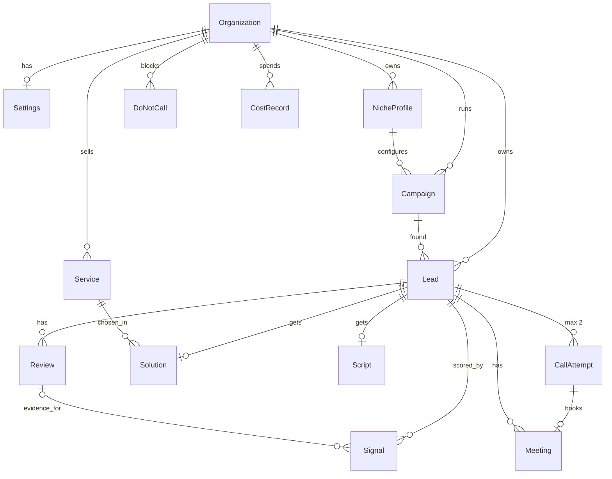

# Database

The schema lives in [`prisma/schema.prisma`](../prisma/schema.prisma). This page explains it. If the two disagree, the schema wins and this page gets fixed in the same PR.

## Entity map

## Lifecycles

**Campaign:** `DISCOVERING → ENRICHING → SCORING → SCRIPTING → AWAITING_APPROVAL → CALLING → COMPLETED`. Any active stage (not `COMPLETED`) can go to `PAUSED` (operator) or `FAILED`; `PAUSED` can also go to `FAILED`. Resume returns to the stage stored in `pausedFrom`. `COMPLETED` and `FAILED` are final.

**Lead:** `DISCOVERED → ENRICHED → SCORED → READY_TO_CALL → IN_CALLING → BOOKED | CLOSED`.
Side exits: `FILTERED_OUT` (ideal-client filter), `NO_STRONG_SIGNAL` (no evidence-backed problem), `NEEDS_REVIEW` (solution invalid twice), `FAILED` (see `failedStep`, `error`). Cold leads stay at `SCORED`.

**CallAttempt:** `SCHEDULED → DIALING → ENDED`, or `DENIED` (a policy blocked it) or `CANCELLED`.

## Invariants (enforced by the database, not just code)

| Rule                                                 | How                                                                                                     |
| ---------------------------------------------------- | ------------------------------------------------------------------------------------------------------- |
| One lead per business per organization               | `@@unique([organizationId, placeId])` on `Lead`                                                         |
| Never more than 2 call attempts per business         | `@@unique([leadId, attemptNumber])` + `CHECK ("attemptNumber" IN (1, 2))` in the first migration        |
| A call is never placed twice                         | `idempotencyKey @unique`, `vapiCallId @unique`                                                          |
| A signal counts once per lead                        | `@@unique([leadId, key])` on `Signal`                                                                   |
| One solution and one script per lead                 | `leadId @unique` on `Solution`, `Script`                                                                |
| One meeting per call, one calendar event per meeting | `callAttemptId @unique`, `calendarEventId @unique`                                                      |
| A blocked number stays blocked                       | `@@unique([organizationId, phone])` on `DoNotCall`; checked by the do-not-call policy before every dial |
| Niche settings of old campaigns stay explainable     | `NicheProfile` rows are versioned (`@@unique([organizationId, slug, version])`) and never edited        |
| A paused campaign knows where to resume              | `CHECK`: `pausedFrom` set exactly while `PAUSED`, never to `PAUSED`, `COMPLETED` or `FAILED`            |

## Conventions

- IDs are `cuid()` strings. Times are stored in UTC; the dashboard shows Asia/Karachi.
- Money is `Decimal`, never `Float`. `CostRecord.amountUsd` has 5 decimals because a single embedding call costs fractions of a cent.
- Phones are stored in E.164 (`+923001234567`).
- Every row belongs to an `Organization`, even though v1 has one. This keeps the later multi-agency version a data change, not a rewrite.
- JSON columns (`Settings.*`, `NicheProfile.idealClient`, `signalWeights`, `Lead.scoreBreakdown`, `businessContext`) are validated with Zod schemas from `packages/shared` on every write.
- Deleting a lead cascades to its reviews, signals, solution, script, attempts and meetings. Cost records keep the money history (`SetNull`).

## Retention (NFR-6)

The daily retention loop clears `CallAttempt.transcript` and `recordingUrl` after `Settings.retentionDays` (default 90). The result, reason code and remarks stay.

## First migration checklist

1. `CREATE EXTENSION IF NOT EXISTS vector;` at the top.
2. `ALTER TABLE "CallAttempt" ADD CONSTRAINT attempt_number_1_or_2 CHECK ("attemptNumber" IN (1, 2));`
3. `CREATE INDEX service_embedding_hnsw ON "Service" USING hnsw (embedding vector_cosine_ops);`

Create it with `pnpm prisma migrate dev --create-only --name init`, add the three lines by hand, then `pnpm prisma migrate dev`. Prisma 7 does not run `generate` for you: run `pnpm prisma generate` after.

Prisma has no HNSW index type, so `Service` also declares `@@index([embedding], map: "service_embedding_hnsw")`. The name is what matters: without that line Prisma reads the hand-made index as drift, `migrate dev` asks for a new migration, and that migration drops the index. The real index is still the HNSW one from the migration; an integration test checks it.

## Run tables

The `agent_*` tables at the end of the schema are the HazelJS Agent OS stores, copied from `@hazeljs/agent`'s `prisma-schema.example.prisma`. The only edit is `AgentStep[]?` to `AgentStep[]`, because Prisma rejects optional lists. They follow HazelJS's naming, not the conventions above.

## Test database

Integration tests run against `voxflow_test`, on the server in `DATABASE_URL`. `apps/api/test/test-database.ts` drops and recreates it, then runs `prisma migrate deploy`, so development data is never touched.

## Changing the schema

Follow the `db-change` skill (`.claude/skills/db-change/SKILL.md`): PRD or ADR first, one migration per PR, never edit a migration that is on `main`.
