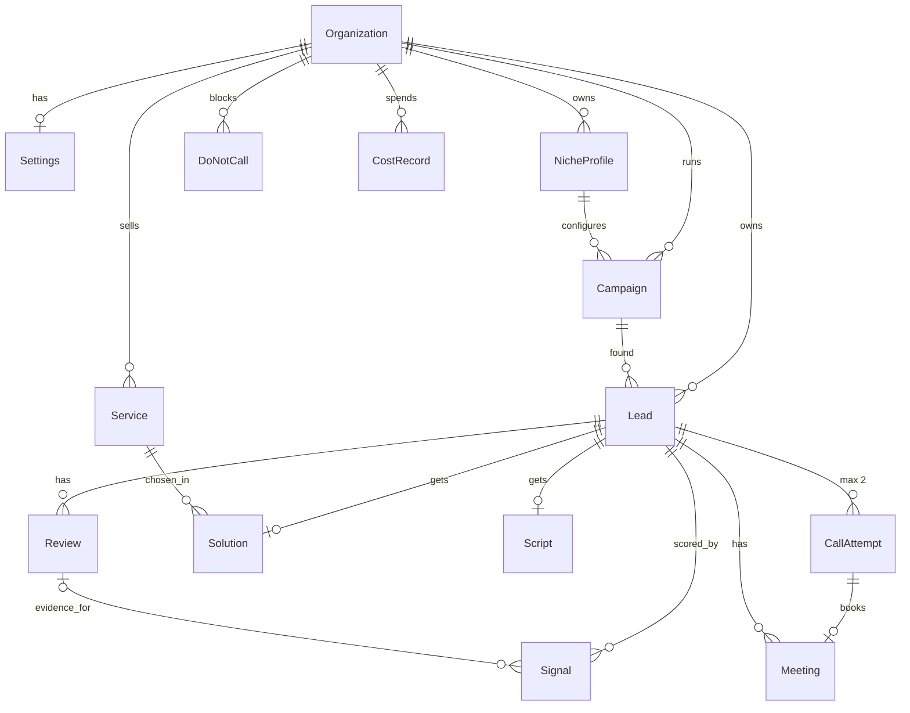

# Database

The schema lives in [`prisma/schema.prisma`](../prisma/schema.prisma). This page explains it. If the two disagree, the schema wins and this page gets fixed in the same PR.

## Entity map

## Lifecycles

**Campaign:** `DISCOVERING → ENRICHING → SCORING → SCRIPTING → AWAITING_APPROVAL → CALLING → COMPLETED`. Any active stage (not `COMPLETED`) can go to `PAUSED` (operator) or `FAILED`; `PAUSED` can also go to `FAILED`. Resume returns to the stage stored in `pausedFrom`. `COMPLETED` and `FAILED` are final.

**Lead:** `DISCOVERED → ENRICHED → SCORED → READY_TO_CALL → IN_CALLING → BOOKED | CLOSED`.
Side exits: `FILTERED_OUT` (ideal-client filter), `NO_STRONG_SIGNAL` (no evidence-backed problem), `NEEDS_REVIEW` (solution invalid twice), `FAILED` (see `failedStep`, `error`). Cold leads stay at `SCORED`.

**CallAttempt:** `SCHEDULED → DIALING → ENDED`, or `DENIED` (a policy blocked it) or `CANCELLED`.

## Invariants (enforced by the database, not just code)

| Rule                                                 | How                                                                                                     |
| ---------------------------------------------------- | ------------------------------------------------------------------------------------------------------- |
| One lead per business per organization               | `@@unique([organizationId, placeId])` on `Lead`                                                         |
| Never more than 2 call attempts per business         | `@@unique([leadId, attemptNumber])` + `CHECK ("attemptNumber" IN (1, 2))` in the first migration        |
| A call is never placed twice                         | `idempotencyKey @unique`, `vapiCallId @unique`                                                          |
| A signal counts once per lead                        | `@@unique([leadId, key])` on `Signal`                                                                   |
| One solution and one script per lead                 | `leadId @unique` on `Solution`, `Script`                                                                |
| One meeting per call, one calendar event per meeting | `callAttemptId @unique`, `calendarEventId @unique`                                                      |
| A blocked number stays blocked                       | `@@unique([organizationId, phone])` on `DoNotCall`; checked by the do-not-call policy before every dial |
| Niche settings of old campaigns stay explainable     | `NicheProfile` rows are versioned (`@@unique([organizationId, slug, version])`) and never edited        |
| A paused campaign knows where to resume              | `CHECK`: `pausedFrom` set exactly while `PAUSED`, never to `PAUSED`, `COMPLETED` or `FAILED`            |

## Conventions

- IDs are `cuid()` strings. Times are stored in UTC; the dashboard shows Asia/Karachi.
- Money is `Decimal`, never `Float`. `CostRecord.amountUsd` has 5 decimals because a single embedding call costs fractions of a cent.
- Phones are stored in E.164 (`+923001234567`).
- Every row belongs to an `Organization`, even though v1 has one. This keeps the later multi-agency version a data change, not a rewrite.
- JSON columns (`Settings.*`, `NicheProfile.idealClient`, `signalWeights`, `tiers`, `Lead.scoreBreakdown`, `websiteEvidence`, `businessContext`) are validated with Zod schemas from `packages/shared` on every write.
- Deleting a lead cascades to its reviews, signals, solution, script, attempts and meetings. Cost records keep the money history (`SetNull`).

## Campaign discovery fields

- `Campaign.discoveryClaimedAt` is the campaign runner's expiring lease (#10). The runner claims a `DISCOVERING` campaign by setting it, renews it before each search and clears it when it stops. A claim older than the lease counts as abandoned, so a crashed worker's campaign is picked up again.
- `Lead.graphClaimedAt` is the lead runner's expiring lease (#15, FR-32, NFR-2). The runner claims a lead with one atomic `UPDATE … WHERE` that sets it, keeps it while the lead's graph runs and clears it when the run ends. A claim older than the lease counts as abandoned, so a crashed worker's lead is picked up again. Its steps skip work already done, so the lead is not processed twice.
- `Campaign.pauseReason` says why the system paused a campaign, for example a spend cap (FR-33). It is null for an operator pause, and resume clears it.
- A discovery search has one live `CostRecord` (service `APIFY`), written before its paid run starts. Its `note` is JSON with `term`, `area`, `runId` and `state`. `runId` is null until Apify accepts the start. `state` is `OPEN`, `CHECK_APIFY` (the campaign paused so the founder can look for its run) or `ABANDONED` (he resumed; a new record takes over and this one keeps its amount). `units` stays null until the search is stored; until then `amountUsd` holds the run's charge limit, so an unfinished run counts against the daily cap.
- `Lead.campaignId` is the campaign that first found a place, with one exception: a place filtered out as temporarily closed moves to the campaign whose search later shows it open. It counts as new there, not as a duplicate. The first campaign keeps its counts.

## Lead website fields

- The enrich step (#11) sets `websiteStatus` (`NONE`, `READ_FETCH`, `READ_LIGHTPANDA` or `UNREADABLE`), `emails`, `whatsappLinks`, `socialLinks`, `hasOnlineBooking`, `hasChatWidget` and `decisionMakerName`, the first doctor found (homepage, then contact page). A second run replaces them.
- For an `UNREADABLE` site, `hasOnlineBooking` and `hasChatWidget` stay null (unknown), never false, so scoring gives no points for "no online booking".
- `Lead.websiteEvidence` (Zod `WebsiteEvidence`) holds what the extractors matched, as found: `doctors`, `treatments`, `onlineBooking` and `chatWidgets`; `pagesRead`, the URLs of the pages checked, which are the evidence for "no online booking"; and `unreadableReason`, the reader's fixed words, for an `UNREADABLE` site. Scoring (#14) reads it, so a point can cite its evidence (FR-14). It is null until the website is read; a lead with no website gets empty lists.

## Review labels

- `Review.labels` holds the labels the review-labelling task (#13, FR-13) gave the review, taken from the niche profile's `reviewLabels` (e.g. `PHONE_UNANSWERED`, `BOOKING_OR_WAIT`). The labelling output schema (#13) requires at least one label per review (`OTHER` when nothing else fits), so an empty list means "not labelled yet".
- Saving the same reviews again (e.g. a restart collecting the same pass-2 run) updates the text, rating, date and reply flag of rows that exist but never their labels, so labels are not wiped. Scoring (#14) counts labels over the 30 newest reviews by `publishedAt`.
- `NicheProfile.reviewLabels` is the list a niche version allows, seeded from its file like the other niche fields (so it is part of the "raise the version to change it" check). The #13 migration backfilled every stored `dental-clinic` version with the six labels its file has always listed.
- The labelling step sends only the unlabelled reviews among the 30 newest, so a repeat run pays for nothing twice, and it never overwrites labels: when two runs race, the first run's labels stay.

## Niche score thresholds

- `NicheProfile.tiers` (`{ hot, warm }`) holds the score thresholds of that niche version (FR-15): hot at or above `hot`, warm at or above `warm`, cold below. It is seeded and checked like the other niche fields. The #14 migration backfilled every stored `dental-clinic` version with `{ hot: 70, warm: 45 }`, which its file has always listed.

## Lead score

- The score step (#14) sets `Lead.score` (0–100), `scoreBreakdown` (Zod `ScoreBreakdown`: `pain`, `fit`, `reachability`, `abilityToPay`), `tier` and status `SCORED`. It replaces the lead's `Signal` rows in the same transaction, so the stored score is always the sum of the stored signals' points (FR-14).
- A `Signal` row exists only for a signal that found evidence (`evidence` never empty), once per key (`@@unique([leadId, key])`). Review signals cite the newest matching review in `reviewId` and quote the two newest. Website signals cite the first page read in `sourceUrl`.
- The points come from the campaign's niche version (`NicheProfile.signalWeights`) and the tier from its `tiers`, so an old campaign keeps scoring by the rules it was created with.

## Retention (NFR-6)

The daily retention loop clears `CallAttempt.transcript` and `recordingUrl` after `Settings.retentionDays` (default 90). The result, reason code and remarks stay.

## First migration checklist

1. `CREATE EXTENSION IF NOT EXISTS vector;` at the top.
2. `ALTER TABLE "CallAttempt" ADD CONSTRAINT attempt_number_1_or_2 CHECK ("attemptNumber" IN (1, 2));`
3. `CREATE INDEX service_embedding_hnsw ON "Service" USING hnsw (embedding vector_cosine_ops);`

Create it with `pnpm prisma migrate dev --create-only --name init`, add the three lines by hand, then `pnpm prisma migrate dev`. Prisma 7 does not run `generate` for you: run `pnpm prisma generate` after.

Prisma has no HNSW index type, so `Service` also declares `@@index([embedding], map: "service_embedding_hnsw")`. The name is what matters: without that line Prisma reads the hand-made index as drift, `migrate dev` asks for a new migration, and that migration drops the index. The real index is still the HNSW one from the migration; an integration test checks it.

## Run tables

The `agent_*` tables at the end of the schema are the HazelJS Agent OS stores, copied from `@hazeljs/agent`'s `prisma-schema.example.prisma`. The only edit is `AgentStep[]?` to `AgentStep[]`, because Prisma rejects optional lists. They follow HazelJS's naming, not the conventions above.

## Test database

Integration tests run against `voxflow_test`, on the server in `DATABASE_URL`. `apps/api/test/test-database.ts` drops and recreates it, then runs `prisma migrate deploy`, so development data is never touched.

## Changing the schema

Follow the `db-change` skill (`.claude/skills/db-change/SKILL.md`): PRD or ADR first, one migration per PR, never edit a migration that is on `main`.
