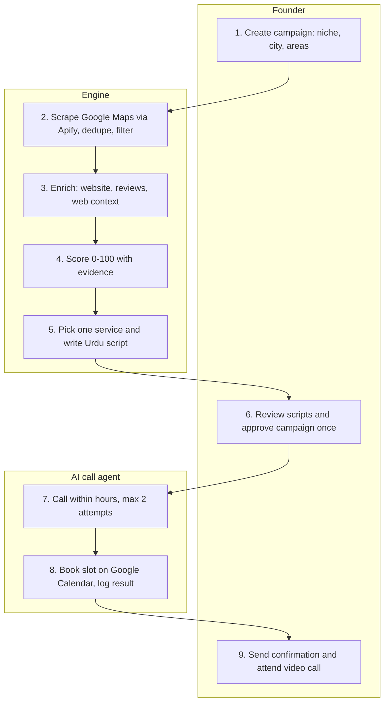
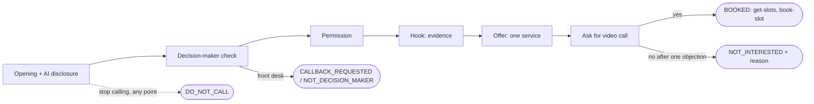
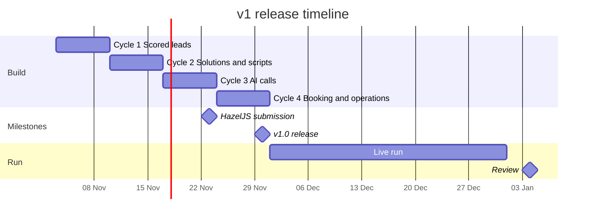

# VoxFlow Lead Engine — Product Requirements Document (v1)

Nov 3, 2026 · Muhammad Fahad

## Document control

| Field               | Value                                                                                                                                              |
| ------------------- | -------------------------------------------------------------------------------------------------------------------------------------------------- |
| Product             | VoxFlow Lead Engine                                                                                                                                |
| Document version    | 0.4 (FR-8 clarified: closed places and keyword forms)                                                                                              |
| Status              | Draft, awaiting owner review                                                                                                                       |
| Owner               | Muhammad Fahad, Founder, VoxFlow AI Solutions                                                                                                      |
| Technical reviewer  | Claude                                                                                                                                             |
| Target release      | v1.0 by Nov 30, 2026                                                                                                                               |
| Related documents   | VoxFlow Lead Engine — HazelJS Build Plan (earlier plan; this PRD supersedes its scope and schedule), VoxFlow Lead Engine — Tech Stack Fundamentals |
| Repository location | `docs/prd.md` (source of truth; changes go through pull requests)                                                                                  |

Requirement words follow the usual convention: **must** = required for v1, **should** = expected but can slip to the next cycle, **won't** = deliberately excluded from v1.

## Overview

VoxFlow Lead Engine v1 turns one dashboard command into booked video calls with the founder. It finds local businesses on Google Maps, scores how much they need AI automation, picks the right VoxFlow service, and calls them in Urdu with an AI voice agent.

The v1 pipeline, end to end:

1. The founder creates a campaign: niche, city, areas.
2. The system scrapes matching businesses through Apify, removes duplicates and poor fits.
3. It reads each business's website, reviews and web context, and scores it from 0 to 100 with evidence.
4. It picks the one VoxFlow AI automation service that would save that business the most time or money.
5. It writes a short, structured Urdu call script for that business.
6. The founder approves the campaign's scripts once.
7. An AI agent calls each business (at most twice), pitches the solution, and books a video call with the founder on his Google Calendar.
8. Every call's result, reason and remarks are logged in English on the dashboard.

v1 stops at the call. Email, automated WhatsApp and follow-up sequences are out of scope until the system has run for one month on real data.

Three outcomes define success: 2 new clients a month for VoxFlow, a working public HazelJS submission by 23 Nov 2026, and a codebase built to junior-developer industry standards.

## Problem statement

VoxFlow has no repeatable way to find and reach clients, so new business depends on the founder's spare time. Today every step is manual: searching Google Maps, opening websites, guessing what a business needs, and calling or messaging one by one.

This causes four problems:

- **Slow.** Researching one business by hand takes long enough that only a handful get contacted each week.
- **Generic.** Pitches are not built on evidence about the specific business, so they sound like every other agency.
- **Untracked.** There is no record of who was contacted, what they said, or why they declined, so nothing improves over time.
- **Wrong channels.** In the Pakistani SME market, cold email gets very low response, and cold WhatsApp messages risk getting the business number blocked. A phone call is the channel these businesses actually answer.

The opportunity: Pakistani clinics and service businesses visibly lose customers to unanswered phones, slow booking and unanswered reviews. That evidence is public, in their Google reviews and websites, and it maps directly onto the services VoxFlow sells. A system that reads the evidence, pitches the matching service by phone in Urdu, and books the meeting removes almost all of the founder's manual work.

## Goals and success metrics

The headline goal is 2 new VoxFlow clients a month from AI calls, measured over the December 2026 live run. Every other metric supports that goal or one of the two side goals (HazelJS submission, engineering practice).

| ID  | Goal                        | Metric                                                      | Target                                       | Measured                              |
| --- | --------------------------- | ----------------------------------------------------------- | -------------------------------------------- | ------------------------------------- |
| G1  | Win clients                 | Clients signed from meetings the engine booked              | ≥ 2 per month                                | Dec 2026 run, reviewed early Jan 2027 |
| G2  | Fill the founder's calendar | Video calls booked by the AI agent                          | ≥ 10 per month                               | Weekly, on the dashboard              |
| G3  | Reach enough businesses     | Businesses called at least once                             | ≥ 1,000 per month                            | Weekly, on the dashboard              |
| G4  | Save founder time           | Founder's daily time spent operating the engine             | ≤ 30 minutes a day                           | Self-reported, weekly                 |
| G5  | Keep LLM cost low           | Pipeline LLM spend (Claude Haiku 5.5)                       | < $10 per month, hard cap                    | Cost page, daily                      |
| G6  | Never stall                 | Campaigns that finish without manual repair                 | 100% (failed leads isolated and retryable)   | Per campaign                          |
| G7  | Ship the HazelJS submission | Public repo submitted; runs from a fresh clone in demo mode | Submitted by 23 Nov 2026; setup ≤ 10 minutes | Fresh-clone test before submitting    |
| G8  | Build like a company        | Merges through pull requests with green CI                  | 100% of merges                               | GitHub history                        |
| G9  | Test what matters           | Line coverage on scoring rules and adapters                 | ≥ 80%                                        | CI coverage report                    |

**Planning model for G1–G3.** These rates are assumptions to be replaced by real December data: about 2,000 businesses scraped → 1,000 qualify (warm or hot) → 500 answer a call → 10 book a meeting (2% of answered calls) → 2 become clients (20% of meetings). If a rate comes in lower, the dashboard shows which stage to fix.

## Non-goals for v1

v1 deliberately stops at the call. The system won't:

- **Send email of any kind.** No cold email, no Gmail API, no sending domain.
- **Send or receive WhatsApp messages automatically.** The only WhatsApp touch is a button that opens WhatsApp on the founder's phone with a prefilled confirmation he sends himself.
- **Run follow-up sequences.** Beyond the 2-call limit per business, nothing is retried or chased.
- **Handle replies or conversations** outside the AI call itself.
- **Close sales on the call.** The agent books a meeting; the founder closes.
- **Support more than one user or company.** No login, roles or multi-agency features. Tables still carry an organization ID so this can be added later.
- **Run in the cloud.** v1 runs on the founder's laptop; no VPS, no cloud deployment.
- **Cover more than one niche and city per campaign.** v1 launches with dental clinics in Lahore; other niches and cities are configuration, added after v1.
- **Use HazelJS Skillgate, MCP export, Agent DNA or per-lead memory.** These are kept for later versions.

## Users and personas

One person operates the system; two kinds of people hear from it; one reviews the code.

| Persona                            | Who they are                                                            | What they need                                                                                             | How v1 serves them                                                                                                                          |
| ---------------------------------- | ----------------------------------------------------------------------- | ---------------------------------------------------------------------------------------------------------- | ------------------------------------------------------------------------------------------------------------------------------------------- |
| **Operator: the founder**          | Muhammad Fahad, runs VoxFlow; technical; limited time                   | Qualified meetings on his calendar with minimal daily effort; full visibility of what was pitched and said | Campaign form, one approval per campaign, booked meetings on Google Calendar, call results and remarks on the dashboard                     |
| **Call recipient: decision-maker** | Clinic owner, doctor or practice manager in Lahore; busy; Urdu-speaking | A short, respectful call that names a real problem in their business and offers a clear next step          | Structured Urdu script built on evidence from their own reviews and website; AI disclosure up front; one ask: a video call with the founder |
| **Call recipient: front desk**     | Receptionist who usually answers the clinic phone                       | Know who is calling and why; pass the message on quickly                                                   | Script branch that asks for the decision-maker's name and best time to call back                                                            |
| **Reviewer: HazelJS evaluator**    | Member of the HazelJS team assessing the ambassador submission          | Install and run the project quickly; see real Agent OS usage and clean code                                | Public repo, demo mode with fake data and a simulated call, README with setup steps and the HazelJS features used                           |

## End-to-end user journey

The founder touches the flow three times: to start a campaign, to approve it once, and to attend the meeting. Everything between is done by the engine and the AI call agent.

Read top to bottom; each box sits in the lane of whoever does that step. Leads that are cold, filtered out or `no strong signal` leave the flow before the approval step and are never called.

## User stories

Seventeen stories in six epics cover v1. Each becomes one or more GitHub issues; its acceptance criteria become the tests that prove it is done.

### E1. Campaigns and discovery

- **US-1** As the founder, I want to create a campaign from a niche, a city and a list of areas, so that I can start finding businesses in one step.
  - The form rejects an empty niche, city or area list with a clear message.
  - On submit, the campaign is saved with status `discovering` and the pipeline starts.
  - The campaign page shows how many searches the grid contains (search terms × areas) before results arrive.
- **US-2** As the founder, I want the system to find matching businesses on Google Maps, so that I don't search by hand.
  - Each Google place appears once across all campaigns; a repeat is skipped and counted as a duplicate.
  - Businesses that fail the ideal-client filter are kept with status `filtered_out` and the rule that excluded them.
  - The campaign page shows found, duplicate, filtered and qualified counts.

### E2. Enrichment and scoring

- **US-3** As the founder, I want each business's website, reviews and web context collected automatically, so that scoring has real evidence.
  - A website is read by plain fetch first and by Lightpanda only when the page needs JavaScript.
  - A site that is blocked or broken is marked `unreadable`; the lead continues with Maps data only.
  - Emails, WhatsApp links, social links, booking or chat widgets, and phone type (mobile or landline) are stored when found.
- **US-4** As the founder, I want every business scored from 0 to 100 with the evidence behind each point, so that I can trust and check the score.
  - Every point awarded links to a stored signal with its proof (review text or page).
  - A signal without proof awards no points.
  - The lead page shows the score broken down by pain, fit, reachability and ability to pay, plus the tier.

### E3. Solution and script

- **US-5** As the founder, I want the system to pick the one VoxFlow service that best fits each qualified business, so that every call pitches something specific.
  - Only warm and hot leads get a solution.
  - The solution is always a service from the catalog, with a one-sentence reason and the signals behind it.
  - When evidence is weak, the result is `no strong signal` and the lead is not called.
- **US-6** As the founder, I want a short Urdu call script generated for each business, so that the AI agent's pitch is specific to them.
  - The script follows the fixed structure in Call design and fills its variables from the lead's data.
  - The script mentions at least one real piece of evidence about the business.
- **US-7** As the founder, I want to add and edit services in the catalog, so that the engine pitches whatever VoxFlow sells.
  - Saving a service updates what the solution step can choose from, without code changes.

### E4. Approval and calling

- **US-8** As the founder, I want to approve each campaign's scripts once, so that nothing is said on my behalf without my review.
  - The approval screen shows the script template and at least 5 generated sample scripts.
  - Approve queues the campaign's calls; reject sends it back for regeneration with my note.
  - No call is placed for a campaign that is not approved.
- **US-9** As the founder, I want the AI agent to call each qualified business in Urdu, so that I reach businesses on the channel they answer.
  - Calls are placed only inside allowed calling hours.
  - Every call opens by saying the caller is an AI assistant calling for VoxFlow.
  - A number on the do-not-call list is never dialled.
- **US-10** As the founder, I want unanswered businesses tried once more at a different time of day, so that we don't lose leads to one missed call.
  - No business is called more than 2 times, ever, across all campaigns.
  - A second attempt is scheduled in the opposite time window on the next allowed day, or at the time the person asked for.

### E5. Booking and outcomes

- **US-11** As the founder, I want the agent to book interested businesses into a free slot on my Google Calendar during the call, so that meetings land without my involvement.
  - The agent offers exactly 2 free slots that respect my availability settings.
  - A confirmed booking creates a calendar event with a Google Meet link and the lead summary.
  - A slot that becomes busy before confirmation is never double-booked.
- **US-12** As the founder, I want a one-click way to send the meeting confirmation, so that the business gets the link from my own WhatsApp.
  - The button opens WhatsApp with the business's number and a prefilled message containing date, time and Meet link.
- **US-13** As the founder, I want every call's result, reason and remarks recorded in English, so that I know who to approach and how.
  - Each attempt stores a result from the fixed outcome list, a reason code where relevant, and 1–3 sentences of English remarks.
  - The transcript and recording link are attached to the attempt.

### E6. Dashboard and operations

- **US-14** As the founder, I want to filter, sort and export leads, so that I can work the list my way.
  - Filters: campaign, tier, call result, score range. Export produces a CSV of the filtered rows.
- **US-15** As the founder, I want a weekly funnel and a cost page, so that I see what works and what it costs.
  - The funnel shows scraped, qualified, called, answered, booked and won counts for the selected week.
  - The cost page shows spend per service against its cap.
- **US-16** As the founder, I want to be alerted when something fails or a cap is hit, so that problems never sit unnoticed.
  - Failed leads show the error and a retry button; a spend cap pauses the affected step and shows a banner.
- **US-17** As a HazelJS evaluator, I want to run the whole flow on fake data, so that I can assess the project without paid accounts.
  - With demo mode on, a fresh clone runs one campaign end to end, including a simulated call, using only Docker and the README steps.

## Functional requirements

36 numbered requirements define what v1 does; 34 are must, 2 are should. Each traces back to a user story, and each GitHub issue names the FR it implements.

| ID    | Area       | Requirement                                                                                                                                                                                                                                                                                                                                                                                        | Priority | Story       |
| ----- | ---------- | -------------------------------------------------------------------------------------------------------------------------------------------------------------------------------------------------------------------------------------------------------------------------------------------------------------------------------------------------------------------------------------------------- | -------- | ----------- |
| FR-1  | Campaigns  | Create a campaign from a niche profile, a city and at least one area; validate input with Zod.                                                                                                                                                                                                                                                                                                     | Must     | US-1        |
| FR-2  | Campaigns  | Build the search grid as the niche profile's search terms × the campaign's areas, and show its size. Cap results per search (default 100) and show each campaign's duplicate rate, because Apify bills overlapping results before deduplication. If the chosen actor supports a city-wide or polygon search with equal coverage, use it instead of overlapping area searches (decided in Cycle 1). | Must     | US-1        |
| FR-3  | Campaigns  | Track campaign status: `discovering` → `enriching` → `scoring` → `scripting` → `awaiting_approval` → `calling` → `completed`, plus `paused` and `failed`.                                                                                                                                                                                                                                          | Must     | US-1, US-8  |
| FR-4  | Campaigns  | Store per niche profile: search terms, ideal-client rules, signal weights and the script template. Seed a dental-clinic profile.                                                                                                                                                                                                                                                                   | Must     | US-1, US-4  |
| FR-5  | Discovery  | Run the Apify Google Maps actor once per grid search, wait for completion, read the dataset, and validate every item with Zod.                                                                                                                                                                                                                                                                     | Must     | US-2        |
| FR-6  | Discovery  | Normalize phone numbers to international format (+92…) and website URLs.                                                                                                                                                                                                                                                                                                                           | Must     | US-2        |
| FR-7  | Discovery  | Store each Google place once across all campaigns (unique place ID); count repeats as duplicates. One exception: a stored place filtered as temporarily closed is re-checked when a later search shows it open.                                                                                                                                                                                    | Must     | US-2        |
| FR-8  | Discovery  | Apply the ideal-client filter (default: private clinic, rating ≥ 4.0, ≥ 30 reviews, not a hospital or chain); closed places are excluded, and keywords cover plurals and government or school names; store the reason for any exclusion.                                                                                                                                                           | Must     | US-2        |
| FR-9  | Enrichment | Read websites in tiers: plain fetch, then Lightpanda when the page needs JavaScript, else mark `unreadable`. Read only the homepage and a contact page, respect robots.txt, one request per domain at a time.                                                                                                                                                                                      | Must     | US-3        |
| FR-10 | Enrichment | Extract emails, `wa.me` links, social links and booking or chat widgets; classify the phone as mobile or landline.                                                                                                                                                                                                                                                                                 | Must     | US-3        |
| FR-11 | Enrichment | Store up to the 30 most recent Google reviews per business.                                                                                                                                                                                                                                                                                                                                        | Must     | US-3        |
| FR-12 | Enrichment | For leads that pass the ideal-client filter, fetch a business-context summary through Perplexity Search.                                                                                                                                                                                                                                                                                           | Should   | US-3        |
| FR-13 | Scoring    | Use Claude Haiku 5.5 to label reviews and site content into the defined signal types, returning JSON validated by Zod.                                                                                                                                                                                                                                                                             | Must     | US-4        |
| FR-14 | Scoring    | Compute the score with the rules in Lead scoring model; link every point to a stored signal with its evidence.                                                                                                                                                                                                                                                                                     | Must     | US-4        |
| FR-15 | Scoring    | Assign tiers (hot ≥ 70, warm 45–69, cold < 45). Cold leads are never called.                                                                                                                                                                                                                                                                                                                       | Must     | US-4        |
| FR-16 | Solution   | Let the founder create, edit and retire catalog services; embed each saved service into pgvector.                                                                                                                                                                                                                                                                                                  | Must     | US-7        |
| FR-17 | Solution   | For warm and hot leads, retrieve the closest catalog services and have Haiku return one service ID, a one-sentence reason and the supporting signal IDs. Reject any ID not in the catalog or not on the lead; retry once, then mark `needs_review`.                                                                                                                                                | Must     | US-5        |
| FR-18 | Script     | Fill the niche profile's script template with the lead's variables; validate and store the script with the template version used. The model for each LLM task is a setting; Cycle 2 compares Claude Haiku 5.5 and gpt-6-luna (same price) on 10 Urdu scripts and keeps the one the founder rates more natural.                                                                                     | Must     | US-6        |
| FR-19 | Approval   | Move a scripted campaign to `awaiting_approval`; show the template and at least 5 sample scripts; approve or reject with a note. The pending approval must survive a restart (HazelJS durable approval).                                                                                                                                                                                           | Must     | US-8        |
| FR-20 | Calling    | Dial only inside calling hours (default Mon–Sat, 10:00–13:00 and 15:00–18:00 Pakistan time; Friday 12:30–15:00 blocked). Hours are configurable.                                                                                                                                                                                                                                                   | Must     | US-9        |
| FR-21 | Calling    | Check Gatekeeper policies before every call: calling hours, do-not-call list, attempt count, spend caps. Log denied calls with the policy that denied them.                                                                                                                                                                                                                                        | Must     | US-9, US-10 |
| FR-22 | Calling    | Create each Vapi call with the assistant configuration and the lead's variables, using an idempotency key per attempt. Place calls only while the health check passes (database, tunnel and worker up).                                                                                                                                                                                            | Must     | US-9        |
| FR-23 | Calling    | Apply the attempt rules in Call design: at most 2 calls per business, ever.                                                                                                                                                                                                                                                                                                                        | Must     | US-10       |
| FR-24 | Calling    | When a person asks not to be called again, add the number to the do-not-call list permanently.                                                                                                                                                                                                                                                                                                     | Must     | US-9        |
| FR-25 | Booking    | Expose `getSlots` and `bookSlot` endpoints for the agent to use during the call. Serve free slots from a cache refreshed from Google Calendar every 5 minutes, re-check the slot live before booking, and create the event with a Google Meet link and the lead summary.                                                                                                                           | Must     | US-11       |
| FR-26 | Booking    | Store booking settings: working days and hours, meeting length (default 30 min), buffer (default 15 min), maximum meetings a day (default 4), booking horizon (default 7 days).                                                                                                                                                                                                                    | Must     | US-11       |
| FR-27 | Booking    | Show a "Send confirmation" button on booked leads that opens WhatsApp with the business number and a prefilled message (date, time, Meet link).                                                                                                                                                                                                                                                    | Must     | US-12       |
| FR-28 | Outcomes   | Receive Vapi's end-of-call webhook (verified by shared secret); store transcript, recording link, duration and cost. If a webhook is missed because the laptop went offline, a reconciliation job fetches the call's result from Vapi's API on startup and every 15 minutes. Have Haiku produce the result, reason code and 1–3 sentences of English remarks.                                      | Must     | US-13       |
| FR-29 | Outcomes   | Update the lead's status from the outcome and schedule or close its next step.                                                                                                                                                                                                                                                                                                                     | Must     | US-13       |
| FR-30 | Dashboard  | Provide pages: campaigns, new campaign, lead table (filter, sort, CSV export), lead detail, approval, calls today, costs, settings.                                                                                                                                                                                                                                                                | Must     | US-14       |
| FR-31 | Dashboard  | Show the weekly funnel: scraped, qualified, called, answered, booked, won (won is entered by the founder).                                                                                                                                                                                                                                                                                         | Must     | US-15       |
| FR-32 | Operations | Give each lead its own status and error; a failed lead shows a retry button and never stops its campaign.                                                                                                                                                                                                                                                                                          | Must     | US-16       |
| FR-33 | Operations | Enforce spend caps: LLM hard cap of $10 a month; daily caps for Apify, Perplexity and Vapi. Reaching a cap pauses that step and shows a banner.                                                                                                                                                                                                                                                    | Must     | US-16       |
| FR-34 | Operations | Send a daily summary and immediate failure alerts to the founder (channel decided in Cycle 4).                                                                                                                                                                                                                                                                                                     | Should   | US-16       |
| FR-35 | Operations | Show each campaign's run timeline: every step, tool call and state change.                                                                                                                                                                                                                                                                                                                         | Must     | US-16       |
| FR-36 | Demo       | Provide demo mode: fake adapters for Apify, websites, Perplexity, the LLM (recorded responses), Vapi (simulated call and webhook) and Google Calendar.                                                                                                                                                                                                                                             | Must     | US-17       |

## Lead scoring model

A lead's score is the sum of points from 13 signals in four dimensions, out of 100. The weights below are the v1 defaults for the dental-clinic profile; they live in the niche profile and get tuned after the December run.

| Dimension               | Signal                                                                                         | Points | Evidence that must be stored     |
| ----------------------- | ---------------------------------------------------------------------------------------------- | ------ | -------------------------------- |
| Pain (max 40)           | At least 2 of the last 30 reviews say the phone goes unanswered or the clinic is hard to reach | 15     | The review texts                 |
| Pain                    | At least 2 of the last 30 reviews mention difficulty booking or long waits                     | 10     | The review texts                 |
| Pain                    | No online booking on the website or Maps listing                                               | 8      | The pages checked                |
| Pain                    | More than half of the last 30 reviews have no owner reply                                      | 7      | Reply count from the review data |
| Fit (max 25)            | Maps category matches the niche profile                                                        | 10     | The category                     |
| Fit                     | Evidence of several doctors or services                                                        | 8      | Page text or listing             |
| Fit                     | 100 or more Google reviews (patient volume)                                                    | 7      | Review count                     |
| Reachability (max 20)   | Phone number is a mobile number                                                                | 12     | The number and its type          |
| Reachability            | WhatsApp link on the website                                                                   | 4      | The link                         |
| Reachability            | Decision-maker's name found                                                                    | 4      | Page text with the name          |
| Ability to pay (max 15) | Working website                                                                                | 5      | The URL and fetch result         |
| Ability to pay          | Located in an area marked premium in the niche profile                                         | 5      | Address and area                 |
| Ability to pay          | Signs of paid marketing or active social media                                                 | 5      | The page or profile link         |

Rules:

- **No evidence, no points.** A signal without stored proof awards nothing.
- **Each signal counts once**, however many times its evidence appears.
- **Tiers:** hot ≥ 70, warm 45–69, cold < 45. Only warm and hot leads get a solution, a script and a call.
- **Review signals are labelled by Claude Haiku 5.5**, but points are added by plain code, so the same signals always give the same score and the rules are unit-tested.
- **Weights are data, not code.** Changing a weight is a niche-profile edit, recorded with a date so scores stay explainable.

## Call design

Every answered call follows one short, fixed structure with four exits, so the agent responds fast and never improvises a pitch. The only goal of a call is a video call booked with the founder.

A front-desk answer leads to a callback at the time given. A request to stop calling can come at any point and always ends the call on the do-not-call exit.

### Script rules

- **Opener:** greet in Urdu, say it is an AI assistant calling for VoxFlow, say the call may be recorded, and ask for the doctor or owner.
- **Problem:** one sentence naming a real signal from this business's evidence.
- **Solution:** one sentence on the chosen service and what it saves them.
- **Ask:** a 30-minute video call with the founder, offering exactly 2 free slots.
- Each agent turn is at most 2 sentences; the target length of a whole call is under 3 minutes.
- The agent never states facts that are not in the script variables, never quotes prices (pricing is for the founder), and ends politely the moment someone asks it to stop.
- The agent understands replies in Urdu, Roman Urdu and English, and speaks Urdu.

### Call outcomes

| Result                  | Meaning                                                | Next step                                               |
| ----------------------- | ------------------------------------------------------ | ------------------------------------------------------- |
| `BOOKED`                | Meeting booked in a confirmed slot                     | Founder sends the confirmation; lead closed for calling |
| `INTERESTED_NOT_BOOKED` | Interested, but no offered slot worked                 | Founder follows up personally                           |
| `CALLBACK_REQUESTED`    | Asked to be called at another time                     | Attempt 2 at that time, if an attempt remains           |
| `NOT_DECISION_MAKER`    | Front desk answered; name and best time collected      | Attempt 2 at that time, if an attempt remains           |
| `NOT_INTERESTED`        | Declined; reason code recorded                         | Closed                                                  |
| `NO_ANSWER`             | Not answered, busy or voicemail (no voicemail is left) | Attempt 2 in the opposite window                        |
| `WRONG_NUMBER`          | Number does not belong to the business                 | Closed                                                  |
| `DO_NOT_CALL`           | Asked never to be called again                         | Number added to the do-not-call list; closed            |
| `FAILED`                | Technical failure before the phone rang                | Retried by the system; not counted as an attempt        |

Reason codes for `NOT_INTERESTED`: `NO_BUDGET`, `HAS_SOLUTION`, `NOT_NEEDED`, `BAD_TIMING`, `DISTRUSTS_AI`, `OTHER` (explained in the remarks).

### Attempt rules

- A business is dialled at most 2 times, ever, across all campaigns (matched by place ID and phone number).
- Attempt 2 happens in the opposite calling window (morning ↔ afternoon) on the next allowed day, unless the person named a time inside calling hours.
- No attempt 2 after `BOOKED`, `NOT_INTERESTED`, `WRONG_NUMBER` or `DO_NOT_CALL`.
- A `FAILED` call is retried up to 3 times and never uses up an attempt.

### Booking during the call

- The agent calls `getSlots` to fetch 2 free slots within the booking settings, reads them out in Urdu, and calls `bookSlot` on the chosen one.
- `bookSlot` re-checks the calendar; if the slot was just taken it returns the next free slot instead of double-booking.
- The event is titled `VoxFlow intro — <business name>` and carries a Google Meet link, the problem, the pitched service and a link to the lead page.
- The agent repeats the date and time before ending the call. The founder sends the Meet link with the Send confirmation button.

## Non-functional requirements

These 13 requirements set how well v1 must work: reliability, cost, safety and code quality. All are must for v1.

| ID     | Quality           | Requirement                                                                                                                                                                                                                                                                           |
| ------ | ----------------- | ------------------------------------------------------------------------------------------------------------------------------------------------------------------------------------------------------------------------------------------------------------------------------------- |
| NFR-1  | Reliability       | One lead's failure never stops its campaign. Calls to outside services retry up to 3 times with growing waits. Calls, bookings and webhooks are idempotent: a retry never repeats their effect.                                                                                       |
| NFR-2  | Durability        | Pending approvals and paused runs survive a restart. After the laptop wakes, the scheduler catches up on due work without placing duplicate calls.                                                                                                                                    |
| NFR-3  | Responsiveness    | `getSlots` and `bookSlot` answer within 2 seconds for 95% of requests, so the call never stalls. Dashboard pages load within 2 seconds locally with 5,000 leads stored.                                                                                                               |
| NFR-4  | Cost control      | Pipeline LLM spend has a hard cap of $10 a month. Apify, Perplexity and Vapi have daily caps. Cost is recorded per lead and per call.                                                                                                                                                 |
| NFR-5  | Security          | Secrets live only in a git-ignored `.env`; `.env.example` lists every variable with fake values. The public tunnel exposes only webhook and booking-tool routes, each verified with a shared secret. The dashboard listens on localhost only. CI runs a secret scan.                  |
| NFR-6  | Privacy           | The system stores public business information and call data only. Recordings and transcripts are deleted after 90 days by default (configurable). No real lead data enters the public repo; demo data is fictional.                                                                   |
| NFR-7  | Compliance        | Every call opens with the AI disclosure and recording notice, happens inside calling hours, honours do-not-call requests immediately and permanently, and respects the 2-attempt limit. Telemarketing obligations under PTA rules are confirmed before live calls (open question Q1). |
| NFR-8  | Maintainability   | TypeScript strict mode; zero ESLint errors (typescript-eslint strict plus sonarjs rules); zero unused code reported by Knip; every merge through a pull request with green CI; conventional commits; an ADR for each major decision.                                                  |
| NFR-9  | Testability       | Every outside service sits behind an adapter with a fake version. Line coverage ≥ 80% on scoring rules and adapters. An eval set of 10 fictional clinics passes in CI: every solution is from the catalog and no evidence is invented. Each cycle ends with an end-to-end demo run.   |
| NFR-10 | Observability     | Structured logs carry campaign and lead IDs. Each campaign has a run timeline. A health endpoint reports database, tunnel and worker status.                                                                                                                                          |
| NFR-11 | Portability       | Runs on the founder's Windows laptop with Docker Desktop. A fresh clone runs demo mode within 10 minutes using only the README steps.                                                                                                                                                 |
| NFR-12 | Recovery          | The database is backed up nightly to Google Drive; a restore is tested monthly; at most 24 hours of data can be lost.                                                                                                                                                                 |
| NFR-13 | Language and time | The dashboard and remarks are in English, calls are in Urdu, and every time is stored in UTC and shown in Pakistan time (Asia/Karachi).                                                                                                                                               |

## Data model overview

Fifteen entities in PostgreSQL hold everything v1 needs; a lead sits at the centre and owns its reviews, signals, solution, script, calls and meeting. Exact columns and types belong in the architecture doc and the Prisma schema; this table fixes what each entity is for and how they relate.

| Entity             | Purpose                                               | Key fields                                                                                                                            | Relations                                     |
| ------------------ | ----------------------------------------------------- | ------------------------------------------------------------------------------------------------------------------------------------- | --------------------------------------------- |
| `Organization`     | The company using the engine (one seeded row in v1)   | name                                                                                                                                  | Owns every other row                          |
| `NicheProfile`     | How a niche is searched, filtered, scored and pitched | search terms, ideal-client rules, signal weights, premium areas, script template, version                                             | Has many campaigns                            |
| `Campaign`         | One run over a niche, city and areas                  | city, areas, status, approval note, approved at                                                                                       | Belongs to a niche profile; has many leads    |
| `Lead`             | One business found on Google Maps                     | place ID (unique), name, phone (+92 format, indexed), phone type, website, area, rating, review count, score, tier, status, error     | Belongs to a campaign                         |
| `Review`           | A Google review used as evidence                      | text, rating, date, owner replied                                                                                                     | Belongs to a lead                             |
| `Signal`           | One piece of scored evidence                          | dimension, type, points, evidence text or URL                                                                                         | Belongs to a lead                             |
| `Service`          | A catalog entry VoxFlow sells                         | name, problem it solves, fitting signals, expected result, embedding vector, active                                                   | Chosen by solutions                           |
| `Solution`         | The service picked for a lead                         | reason, supporting signal IDs                                                                                                         | Belongs to a lead; points to a service        |
| `Script`           | The call script for a lead                            | template version, variables, text                                                                                                     | Belongs to a lead                             |
| `CallAttempt`      | One dial                                              | attempt number (1 or 2), scheduled at, Vapi call ID (unique), result, reason code, remarks, transcript, recording URL, duration, cost | Belongs to a lead                             |
| `Meeting`          | A booked video call                                   | start, end, calendar event ID (unique), Meet link, confirmation sent at                                                               | Belongs to a lead and the call that booked it |
| `DoNotCall`        | Numbers never to dial again                           | phone (unique), source, added at                                                                                                      | Checked before every call                     |
| `CostRecord`       | Spend per service                                     | service, amount (USD), at                                                                                                             | Optionally tied to a lead or campaign         |
| `Settings`         | Operator configuration                                | calling hours, booking settings, spend caps, retention days                                                                           | One per organization                          |
| HazelJS run tables | Durable agent runs and pending approvals              | as defined by HazelJS's example Prisma schema                                                                                         | Managed by Agent OS                           |

All schema changes go through Prisma migrations committed to the repo; nobody edits the database by hand.

## External dependencies and cost budget

At 2,000 businesses a month, the known costs come to about $31–38 a month before calls. Apify is the largest known cost at about $21–27, measured in the #9 spike (ADR-0015) and about four times the first estimate, because reviews are billed per review. Vapi call minutes and the phone number are still to be priced (Q2, Q3). Prices below were checked on the providers' pages in late October and early November 2026; the Apify rows were measured on the free plan on 4 Nov 2026.

| Dependency                 | Used for                                                       | Price                                                                                                                                                                    | Estimated monthly cost at 2,000 leads |
| -------------------------- | -------------------------------------------------------------- | ------------------------------------------------------------------------------------------------------------------------------------------------------------------------ | ------------------------------------- |
| Apify: Compass Maps places | Discovery: places, phones, websites, listing booking links     | $4.00 per 1,000 places + $2.00 per 1,000 for place details ([source](https://apify.com/compass/crawler-google-places)); measured $0.60 per 100 places                    | ≈ $12 for 2,000 places                |
| Apify: Scraperlink reviews | The 30 newest reviews, only for places that pass the filter    | $0.25 per 1,000 reviews + $0.50 per 1,000 places ([source](https://apify.com/scraperlink/google-maps-scraper)); measured $0.79 per 100 places                            | ≈ $9–15 for 1,200–1,900 places        |
| Perplexity Search API      | Business-context summaries for qualified leads                 | $5 per 1,000 requests; $1 per 1,000 with Fast Search ([source](https://docs.perplexity.ai/guides/pricing.md))                                                            | ≈ $6 for \~1,200 leads                |
| Anthropic Claude Haiku 5.5 | Review labelling, solution, script, call summaries             | $0.10 per million input tokens, $0.50 per million output tokens; Batch API halves both ([source](https://docs.claude.com/en/docs/about-claude/pricing))                  | ≈ $4–5; hard cap $10                  |
| Perplexity Embeddings API  | Catalog vectors for RAG                                        | $0.004 per million tokens ([source](https://docs.perplexity.ai/guides/pricing.md))                                                                                       | < $0.01                               |
| Vapi                       | Outbound AI calls: transcriber, voice, in-call model, webhooks | To be confirmed in Cycle 3. Urdu is listed for the ElevenLabs Scribe, OpenAI and Cartesia transcribers ([source](https://docs.vapi.ai/providers/transcriber/elevenlabs)) | To be priced (Q2)                     |
| Phone number provider      | The number calls come from, imported into Vapi                 | To be chosen (Q3)                                                                                                                                                        | To be priced                          |
| Google Calendar API        | Free/busy lookup and event creation                            | Confirm quotas in Cycle 4                                                                                                                                                | Expected $0                           |
| Cloudflare Tunnel          | Public HTTPS for webhook and booking routes only               | Confirm plan in Cycle 4; needs the voxflow.agency DNS on Cloudflare (Q4)                                                                                                 | Expected $0                           |
| Lightpanda                 | Rendering JavaScript-heavy websites                            | Open source, self-hosted in Docker; telemetry disabled                                                                                                                   | $0                                    |
| HazelJS                    | Backend framework and Agent OS                                 | Open source                                                                                                                                                              | $0                                    |
| GitHub                     | Repository, issues, pull requests, CI                          | Public repository                                                                                                                                                        | $0                                    |

The LLM cost cap covers the pipeline's own Haiku calls. The model Vapi uses during a live call is billed as part of the call cost, not the $10 cap.

## Release plan

v1 ships in four one-week Scrum cycles, from 3 to 30 November 2026, then runs live through December. Each cycle ends with a working increment the founder can use from that day on.

1. **Cycle 1, Scored leads.** Deliverable: a dashboard lead table of enriched, scored leads with evidence, exportable to CSV, ready for manual calling.
   - Scope: repo, CI and tooling; Docker (Postgres, Lightpanda); Prisma schema v1; FR-1 to FR-15; lead table (part of FR-30); FR-32.
   - Exit: a real Lahore dental campaign produces scored leads; scoring-rule coverage ≥ 80%.
2. **Cycle 2, Solutions and scripts.** Deliverable: every warm and hot lead has its service, reason and Urdu script; campaigns can be approved.
   - Scope: FR-16 to FR-19; approval screen; eval set of 10 fictional clinics.
   - Exit: the eval set passes in CI; an approval survives a restart.
3. **Cycle 3, AI calls (HazelJS submission).** Deliverable: approved campaigns are called by the Urdu AI agent, and results, reasons and English remarks appear on the dashboard.
   - Scope: FR-20 to FR-24, FR-28, FR-29, FR-33, FR-35, FR-36; README and demo video.
   - Exit: test calls to the founder's own phones produce correct outcomes; demo mode runs from a fresh clone in ≤ 10 minutes; submission sent on 23 November.
4. **Cycle 4, Booking and operations (v1.0).** Deliverable: interested businesses are booked into the founder's calendar during the call; the engine runs reliably on the laptop.
   - Scope: FR-25 to FR-27, FR-31, FR-34; Cloudflare Tunnel; nightly backups; alerts; cost page.
   - Exit: a test call books a real calendar event with a Meet link; a backup restore succeeds; v1.0 tagged on 30 November.

### Definition of done

An issue is done when:

- [ ] Its acceptance criteria pass as automated tests.
- [ ] Typecheck, lint and Knip are clean, and CI is green.
- [ ] The diff has been self-reviewed and checked by the reviewer subagent.
- [ ] Docs are updated wherever behaviour changed.

A cycle is done when:

- [ ] All its issues are done.
- [ ] Integration tests pass across every earlier cycle.
- [ ] One end-to-end run in demo mode succeeds.
- [ ] The sprint review demo is recorded and a retrospective note is written in `docs/retros/`.

## Risks and mitigations

The two biggest risks are call quality in Urdu and telecom rules on outbound calling; both are tested before the December live run.

| Risk                                                                       | Likelihood | Impact | Mitigation                                                                                                                                                                                          |
| -------------------------------------------------------------------------- | ---------- | ------ | --------------------------------------------------------------------------------------------------------------------------------------------------------------------------------------------------- |
| Calling number gets blocked after complaints, or telemarketing rules apply | Medium     | High   | AI disclosure, calling hours, do-not-call honoured at once, 2-attempt limit, modest daily volume; confirm obligations before live calls (Q1)                                                        |
| Urdu speech recognition errors or slow replies make calls awkward          | Medium     | High   | Short structured script; 10 test calls to the founder's own phones comparing 2 transcriber and voice pairs; pick the best in Cycle 3; compare Haiku 5.5 and gpt-6-luna on script quality in Cycle 2 |
| The front desk answers, not the decision-maker                             | High       | Medium | Script branch collects the decision-maker's name and best time; attempt 2 targets that time                                                                                                         |
| The LLM invents a problem or a service                                     | Medium     | High   | Catalog IDs enforced by Zod; every cited signal must exist on the lead; eval set runs in CI                                                                                                         |
| HazelJS is young and its docs have gaps                                    | Medium     | Medium | Pin versions; study the Meridian reference app; a part that fails may use plain TypeScript, recorded in an ADR                                                                                      |
| Websites block reading, or the Apify actor changes                         | Medium     | Medium | Adapter makes the actor swappable; tiered reading with an `unreadable` fallback                                                                                                                     |
| Laptop offline (power cut, sleep, travel)                                  | High       | Medium | Calls scheduled only while online; durable runs catch up after restart; UPS; sleep disabled while plugged in; missed Vapi webhooks recovered from Vapi's API (FR-28)                                |
| Call costs higher than expected                                            | Medium     | Medium | Price Vapi before live calls (Q2); daily Vapi cap; cost per call on the cost page                                                                                                                   |
| One-week cycles slip                                                       | Medium     | Medium | Cut order: FR-34 alerts, FR-12 Perplexity context, funnel page; tests and the README are never cut; the December run can start up to one week late                                                  |
| A calendar slot is double-booked                                           | Low        | Medium | `bookSlot` re-checks free/busy; calendar event ID is unique                                                                                                                                         |

## Open questions

Ten questions remain; each has a deadline before the cycle that needs its answer. The founder owns all of them.

| ID  | Question                                                                                                                                                                                                                                                                                                                                  | Due          | Needed for        |
| --- | ----------------------------------------------------------------------------------------------------------------------------------------------------------------------------------------------------------------------------------------------------------------------------------------------------------------------------------------- | ------------ | ----------------- |
| Q1  | Do VoxFlow's outbound AI calls require PTA telemarketer registration or Do Not Call Register checks?                                                                                                                                                                                                                                      | Nov 28, 2026 | December live run |
| Q2  | What does a Vapi call cost per minute with the chosen transcriber, voice and in-call model?                                                                                                                                                                                                                                               | Nov 17, 2026 | Cycle 3           |
| Q3  | Which phone number and provider will calls come from, and can it be connected to Vapi?                                                                                                                                                                                                                                                    | Nov 17, 2026 | Cycle 3           |
| Q4  | Is the voxflow.agency domain's DNS on Cloudflare, or does it need moving for the tunnel?                                                                                                                                                                                                                                                  | Nov 24, 2026 | Cycle 4           |
| Q5  | What is the final service catalog (name, problem solved, expected result per service)?                                                                                                                                                                                                                                                    | Nov 10, 2026 | Cycle 2           |
| Q6  | Which Lahore areas go into the first campaign, and which count as premium for scoring?                                                                                                                                                                                                                                                    | Nov 5, 2026  | Cycle 1           |
| Q7  | When is the founder available for meetings (days and hours)?                                                                                                                                                                                                                                                                              | Nov 24, 2026 | Cycle 4           |
| Q8  | Which channel carries alerts and the daily summary (FR-34)?                                                                                                                                                                                                                                                                               | Nov 24, 2026 | Cycle 4           |
| Q9  | Do pages 2–3 of the HazelJS email set a separate deadline or submission link? ANSWERED 3 Nov: no separate deadline; submit the public repo at hazeljs.ai/build#submit. Judging: creativity 20%, practical use of HazelJS 30%, functionality 25%, code quality and docs 15%, real-world impact 10% (mapped in docs/hazeljs-submission.md). | Nov 5, 2026  | Cycle 3           |
| Q10 | Is 90 days the right retention for recordings and transcripts?                                                                                                                                                                                                                                                                            | Nov 17, 2026 | Cycle 3           |

## Future versions

What comes after v1 is decided in early January 2027 from the December data, not now. These are the candidates, in the order they are expected to matter:

1. **WhatsApp follow-up after consent.** The agent asks permission on the call; a yes triggers an approved WhatsApp template.
2. **Reply handling.** An agent answers WhatsApp replies inside the 24-hour window and escalates hard questions to the founder.
3. **More niches and cities.** New niche profiles (salons, skin clinics, restaurants) and cities beyond Lahore.
4. **Scoring that learns.** Signal weights tuned from which leads actually booked and signed.
5. **Audit page per business.** A short public page showing the problems found, used as the hook in follow-ups.
6. **Product for agencies.** Login, organizations, per-agency catalogs and numbers, billing, cloud hosting.

## Appendix

### Glossary

| Term                | Meaning                                                                                                |
| ------------------- | ------------------------------------------------------------------------------------------------------ |
| Campaign            | One run of the engine over a niche, a city and a list of areas                                         |
| Lead                | One business found on Google Maps                                                                      |
| Niche profile       | Configuration for a type of business: search terms, filters, scoring weights, script template          |
| Ideal-client filter | Rules that drop businesses unlikely to buy before any money is spent on them                           |
| Signal              | One piece of evidence about a lead, worth points in the score                                          |
| Tier                | Hot, warm or cold, from the score; only warm and hot leads are called                                  |
| Service catalog     | The list of AI automation services VoxFlow sells, used to pick each lead's solution                    |
| RAG                 | Retrieval-augmented generation: finding the most relevant catalog entries and giving them to the model |
| pgvector            | A PostgreSQL extension that stores embeddings so similar text can be found quickly                     |
| Agent OS            | HazelJS's runtime for agents: graphs, durable runs, approvals, policies, timelines                     |
| Gatekeeper          | HazelJS policy check that allows or denies an action before it runs                                    |
| Durable approval    | A paused run saved in the database so it survives a restart until approved                             |
| Adapter             | Code that wraps one outside service behind an interface, with a real and a fake version                |
| Demo mode           | Running the full flow on fake adapters and fictional data, with no paid accounts                       |
| Do-not-call list    | Numbers the engine must never dial again                                                               |
| Webhook             | An HTTP request an outside service (Vapi) sends to the engine when something happens                   |
| Tunnel              | A Cloudflare connection that gives the laptop a public HTTPS address for webhook routes only           |

### Decision log

| Date        | Decision                                                                                                                   | Reason                                                                                                     |
| ----------- | -------------------------------------------------------------------------------------------------------------------------- | ---------------------------------------------------------------------------------------------------------- |
| 3 Nov 2026  | Cap Apify results per search and track the duplicate rate; choose the actor in Cycle 1                                     | Overlapping area searches are billed before deduplication                                                  |
| 3 Nov 2026  | Serve calendar slots from a 5-minute cache; re-check live only when booking                                                | Instant answers during the call without risking a double booking                                           |
| 3 Nov 2026  | Recover missed Vapi webhooks by polling Vapi's API, not through a cloud relay                                              | Keeps v1 fully local; calls only start while the laptop is online, and booking tools need it online anyway |
| 3 Nov 2026  | The model is a setting per task; Cycle 2 compares Haiku 5.5 and gpt-6-luna for Urdu scripts                                | Same price; choose on measured Urdu quality, not assumption                                                |
| 3 Nov 2026  | Claude Haiku 5.5 as the default for every pipeline LLM task; LLM spend under $10 a month                                   | Lowest cost tier with enough quality; LLM cost is a small share of the total                               |
| 3 Nov 2026  | At most 2 calls per business; one approval per campaign; confirmation sent by the founder from a prefilled WhatsApp button | Respectful calling, low operator effort, no WhatsApp API restrictions                                      |
| 3 Nov 2026  | v1 stops at the call: no email, no automated WhatsApp, no follow-up sequences                                              | Fewer platform restrictions; one month of real data before adding channels                                 |
| 2 Nov 2026  | Run on the founder's laptop instead of a VPS                                                                               | Saves about Rs 6,000 a month; volume fits a laptop                                                         |
| 2 Nov 2026  | Tiered website reading with Lightpanda as the fallback                                                                     | Most clinic sites need only a plain fetch; Lightpanda covers JavaScript-built pages                        |
| 2 Nov 2026  | Build for VoxFlow first, sell to agencies later; every table carries an organization ID                                    | Prove results before selling; avoid a costly retrofit                                                      |
| 29 Oct 2026 | Build on HazelJS in TypeScript; the project doubles as the HazelJS ambassador submission                                   | One build serves both goals; one language end to end                                                       |
| 29 Oct 2026 | Build from scratch with paid, reliable services (Apify, Vapi)                                                              | Reliability over free tools; learn industry practice                                                       |

### Changelog

| Date       | Version | Change                                                                                                |
| ---------- | ------- | ----------------------------------------------------------------------------------------------------- |
| 5 Nov 2026 | 0.4     | FR-8: closed places, keyword plurals, government or school names. FR-7: reopened places re-checked    |
| 4 Nov 2026 | 0.3     | Apify costs measured in the #9 spike: hybrid two-pass design, ≈ $21–27 a month (ADR-0015)             |
| 3 Nov 2026 | 0.2     | Review fixes: Apify result caps, cached calendar slots, Vapi webhook recovery, per-task model setting |
| 3 Nov 2026 | 0.1     | First draft for owner review                                                                          |
